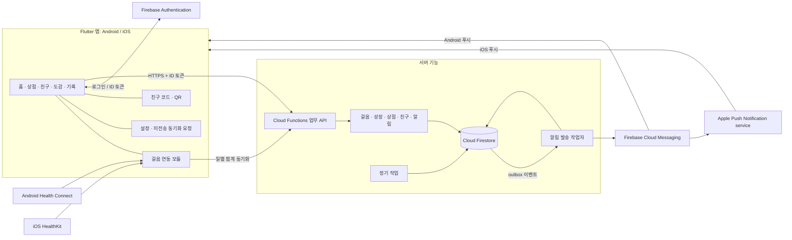
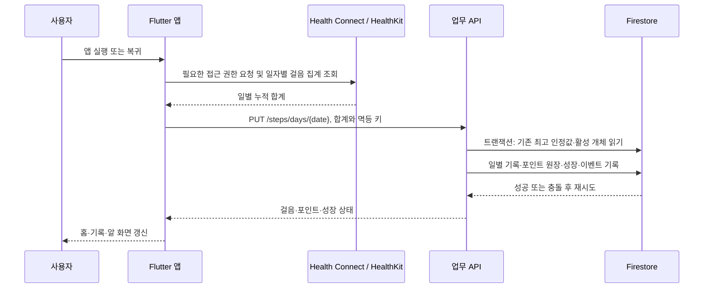
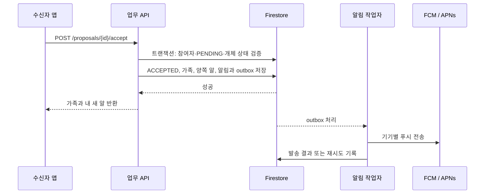

# 시스템 아키텍처 v0.1

프로젝트 README의 Flutter·Firebase 계획을 기준으로 만든 **제안 구조**다. Firestore, Cloud Functions와 FCM은 확정된 구현이 아니라 화면의 기능을 실현하기 위한 선택안이다. 서비스가 커지기 전에는 기능을 나눈 하나의 서버로 시작한다.

## 구성도

## 구성 요소와 역할

| 구성 요소 | 역할 |
| --- | --- |
| Flutter 앱 | 화면·내비게이션, QR 표시/인식, 헬스 데이터 권한 요청, 일별 집계 조회, 서버 API 호출, 필요한 로컬 상태와 재시도 관리 |
| Firebase Authentication | 로그인과 사용자 `uid` 관리. 로그인 수단은 미결정 |
| Cloud Functions 업무 API | 토큰 검증, 사용자·개체별 접근 확인, 게임 규칙, 트랜잭션, 응답 구성 |
| Cloud Firestore | 사용자·걸음 집계·반려동물·포인트·아이템·친구·가족·도감·알림 저장 |
| 알림 작업자와 FCM | 트랜잭션에서 저장한 알림 발송 대상을 읽고 푸시 전송·재시도. iOS는 APNs 연동 필요 |
| 정기 작업 | 하루 산책 요약 등 시간 기반 작업. 실제 발송 시각과 조건은 미결정 |

제안안에서는 앱이 Firestore의 게임 데이터를 직접 쓰지 않는다. 서버가 검증 후 저장하며 Firestore Security Rules는 모바일 클라이언트의 직접 접근을 제한한다. Admin SDK는 Security Rules를 우회하므로, 서버에서도 소유권과 권한을 반드시 검사해야 한다. Firebase ID 토큰은 서버에서 검증한다. [Firebase 토큰 검증 문서](https://firebase.google.com/docs/auth/admin/verify-id-tokens)

## 걸음 동기화와 보상

1. Android에서는 Health Connect의 걸음 데이터를 집계하고, iOS에서는 HealthKit의 일별 걸음 통계를 조회하는 방안을 제안한다. Health Connect는 누적형 걸음 데이터의 여러 출처를 집계할 때 `aggregate()` 사용을 안내한다. [Android 공식 문서](https://developer.android.com/health-and-fitness/health-connect/get-started)
2. 앱은 각 날짜의 **누적 합계**를 보내고 서버는 이전에 보상한 일별 최고값과 비교한다. 같은 값을 반복 전송하거나 원본 수치가 줄어든 뒤 다시 늘어도 이미 보상한 구간을 재지급하지 않는다. 임시 공식과 예시는 [API 명세](api-spec.md#걸음-동기화와-산책-기록)에 있다.
3. 포인트와 성장 변화, 필요한 단계 전환 및 알림 기록은 하나의 트랜잭션으로 처리한다. Firestore 트랜잭션은 경합 시 실행 함수가 재시도될 수 있으므로 외부 발송을 트랜잭션 내부에 넣지 않는다. [Firestore 트랜잭션 문서](https://firebase.google.com/docs/firestore/manage-data/transactions)
4. 연결이 끊기면 앱은 아직 완료되지 않은 요청을 안전하게 재시도한다. 같은 요청에는 같은 멱등 키를 사용하고, 성공 후 로컬 대기 항목을 정리한다. 오프라인 상태에서 서버 잔액을 확정해야 하는 구매·선물은 성공으로 표시하지 않는다.

대표 기기 1대, `Asia/Seoul` 일자 기준, 가입일을 포함한 이후 날짜를 최대 7일 소급하고 동기화 시점의 활성 개체에 성장 반영하는 규칙은 설명을 위한 임시안이다. 가입 당일의 합계에는 가입 전 걸음이 들어갈 수 있고, 늦게 동기화하면 실제 걷던 시점과 다른 개체가 성장할 수 있다. 운영 정책 확정 전에 [D08~D13](open-decisions.md#걸음성장-정책)을 결정해야 한다.

### OS별 고려 사항

- Android Health Connect에서 백그라운드 읽기와 기본 범위를 넘는 과거 데이터 읽기에는 각각 추가 권한이 필요할 수 있다. 기본 과거 조회 범위에도 제한이 있다. 앱 실행 중 동기화는 제공하고, 백그라운드 동기화는 권한·기기 지원 여부에 따라 제공한다. [Android 데이터 읽기 문서](https://developer.android.com/health-and-fitness/health-connect/read-data)
- iOS HealthKit은 개인정보 보호를 위해 읽기 권한 거부 여부를 앱에 직접 알려주지 않는다. 앱은 데이터가 없다는 사실만으로 거부라고 단정하지 않고 설정 안내를 제공한다. [Apple 권한 문서](https://developer.apple.com/documentation/healthkit/authorizing-access-to-health-data)
- iOS 통계 조회는 일별 그래프를 만드는 데 사용할 수 있다. 백그라운드 변경 알림은 별도 방식으로 설계해야 하며 OS 실행 시점을 보장할 수 없다. [Apple HealthKit 읽기 문서](https://developer.apple.com/documentation/healthkit/reading-data-from-healthkit)
- 기기·플랫폼의 실제 읽기 범위, 합산 우선순위, 사용자 권한, 네트워크 상황에 따라 데이터가 늦거나 누락될 수 있다. 화면의 `매일 0시 초기화`는 **날짜 기준의 표시**이며 정각에 기기 데이터가 서버로 전송된다는 보장은 아니다.

## 청혼·선물·알림 처리

동시 수락·취소는 트랜잭션에서 현재 상태를 다시 확인해 한 번만 전이한다. 선물은 발신자의 보관함 차감과 수신자의 보관함 추가를 함께 처리한다. 상대에게 알을 각각 지급하는 방식과 청혼 조건은 임시안이다.

앱 알림함은 Firestore에 저장된 알림이 기준이고 푸시는 사용자를 앱으로 안내하는 수단이다. 트리거는 중복 호출되거나 순서가 달라질 수 있으므로 outbox를 이벤트 ID 기준으로 처리하고 재시도한다. 외부 푸시 전달이 정확히 한 번만 이뤄진다고 보장하지 않는다. [Firebase Firestore 이벤트 문서](https://firebase.google.com/docs/functions/firestore-events)

정기 산책 요약을 구현한다면 `사용자 ID + 대상 날짜 + 알림 유형`으로 생성 키를 고정해 중복 생성을 막는다. 기기 지연 동기화로 자정 시점의 기록이 불완전할 수 있으므로 요약 수정·재발송 여부는 [D24](open-decisions.md#알림운영-정책)에서 결정한다.

## 운영과 접근 제어

- 개발·운영 Firebase 프로젝트를 분리하고 환경별 API 주소와 설정을 관리한다. 실제 사용자 데이터를 개발 환경으로 복사하지 않는 운영 방식을 제안한다.
- 모든 업무 API에서 ID 토큰을 검증하고 본인 소유, 친구 관계, 청혼 참여자 권한을 검사한다. 친구의 전체 반려동물 상태 대신 공개하도록 정한 필드만 반환한다.
- 포인트·재고·가족 관계는 서버에서만 변경한다. 친구 코드 조회와 주요 상태 변경에는 호출 제한을 둔다. App Check 등은 추가 방어책이지만 단말이 보낸 걸음 수가 실제인지 증명하지는 못한다.
- 수집 범위는 일별 걸음 합계로 제한하는 안이다. 원본 건강 샘플이나 위치 데이터를 수집하지 않는 구조를 제안하며, 보유 기간·동의·탈퇴 시 처리 방식은 기획에서 확정한다.
- 오류율, 동기화 지연, 트랜잭션 충돌, 푸시 실패와 주요 비용을 추적한다. 로그에 ID 토큰, 푸시 토큰과 원본 건강 데이터를 남기지 않는다.
- 운영 배포 전 Firebase 프로젝트의 지역, 백업·복구 목표, 알림 재시도 한도, 비용 예산과 데이터 삭제 절차를 정한다.

## 공식 참고 자료

- [Firebase Authentication ID 토큰 검증](https://firebase.google.com/docs/auth/admin/verify-id-tokens)
- [Cloud Firestore 트랜잭션](https://firebase.google.com/docs/firestore/manage-data/transactions)
- [Android Health Connect 시작하기](https://developer.android.com/health-and-fitness/health-connect/get-started), [데이터 읽기와 권한](https://developer.android.com/health-and-fitness/health-connect/read-data)
- [Apple HealthKit 권한](https://developer.apple.com/documentation/healthkit/authorizing-access-to-health-data), [데이터 읽기](https://developer.apple.com/documentation/healthkit/reading-data-from-healthkit)
- [Firebase Cloud Messaging iOS 설정](https://firebase.google.com/docs/cloud-messaging/ios/get-started)
