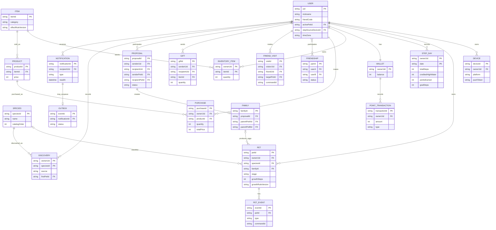

# ERD와 데이터 모델 v0.1

화면 요구사항을 표현한 **논리 ERD**다. 저장소는 README의 Firebase 계획에 맞춰 Cloud Firestore를 제안한다. Firestore는 관계형 DB가 아니므로 아래 `PK`·`FK`는 논리적 식별자와 참조를 뜻하며, DB가 외래 키나 유일성을 자동 보장하지 않는다. 실제 컬렉션 경로와 트랜잭션 규칙은 아래 표에 정리했다.

## 엔터티 관계

`FRIENDSHIP`은 정확히 두 사용자, `PROPOSAL`은 발신자와 수신자 두 사용자 및 각 반려동물을 참조한다. `FAMILY`는 두 부모 반려동물을 참조한다. Mermaid의 관계 기호만으로 정확히 두 명이라는 제약을 표현하기 어려우므로 서버가 검사한다. `PET.speciesId`와 `familyId`는 새 알일 때 `null`일 수 있다.

## Firestore 컬렉션과 주요 필드

공통으로 생성·수정 시각을 UTC로 기록한다. 아래 `uid`는 Firebase Auth 사용자 ID이고 다른 리소스 ID는 서버가 생성하거나 명령 ID에서 파생한다.

| 문서 경로 | 주요 필드 / 용도 |
| --- | --- |
| `users/{uid}` | `nickname`, `friendCode`, `activePetId`, `stepSourceDeviceId`, `timeZone`, `notificationSettings`, `createdAt`, `lastSeenAt`. 현재 활성 개체는 이 필드 하나로 정한다. |
| `friendCodes/{code}` | `uid`. 코드 중복을 막고 코드로 사용자를 찾기 위한 인덱스 문서. 유추가 쉬운 코드 형태·호출 제한은 기획/보안 검토 대상. |
| `users/{uid}/devices/{deviceId}` | `platform`, `pushToken`, `registeredAt`, `lastSeenAt`. 푸시 토큰은 본인 API에서만 등록·갱신. |
| `users/{uid}/pets/{petId}` | `name`, `stage`, `speciesId?`, `familyId?`, `growthSteps`, `growthRuleVersion`, `stats?`, `traits`, `createdAt`. `traits`는 청혼 미리보기·상속 후보를 위한 정보. |
| `users/{uid}/pets/{petId}/events/{eventId}` | `type`, `commandId`, 성장 시 `stepDate`, `oldHighWater`, `newHighWater`, 행동 시 `action`, `itemId`, `appliedEffects`, `createdAt`. 성장·돌봄·단계 전환 이력. |
| `users/{uid}/stepDays/{YYYY-MM-DD}` | `totalSteps`, `creditedHighWater`, `pointsEarned`, `goalSteps`, `observedAt`, `lastSyncedAt`, `sourceDeviceId`, `provider`. `goalSteps`는 해당 일자 첫 저장 시의 목표 스냅샷. |
| `users/{uid}/wallet/main` | `balance`. 최초 보너스가 있으면 동일 트랜잭션에 지급 원장도 생성. |
| `users/{uid}/pointTransactions/{transactionId}` | `amount`(부호 포함), `type`, `sourceId`, `stepDate?`, `commandId`, `createdAt`. 걸음 적립·구매 차감 이력. |
| `users/{uid}/inventory/{itemId}` | `quantity`, `updatedAt`. 같은 아이템 수량을 합쳐 저장. 아이템 효과는 사용 시점의 규칙을 이력에 기록. |
| `users/{uid}/purchases/{purchaseId}` | `productId`, `itemId`, `quantity`, `unitPrice`, `totalPrice`, `commandId`, `createdAt`. 구매 시점의 가격 보존. |
| `items/{itemId}` | `name`, `category`, `effectRuleVersion`, `effectDefinition`, `imageUrl?`, `active`. |
| `products/{productId}` | `itemId`, `price`, `available`, `displayOrder`. 상품과 실제 사용 아이템을 구분. |
| `species/{speciesId}` | `name`, `traits`, `imageUrl?`, `catalogOrder`, `active`. 화면에 나온 24종은 예시. |
| `growthRules/{version}` | 순서가 있는 단계별 누적 걸음 기준, 상태·아이템 효과 버전 참조. 각 개체는 생성 시 적용 버전을 보유. |
| `friendships/{pairId}` | `userA`, `userB`, `memberUids`, `status`, `createdAt`. `pairId`는 정렬된 두 `uid`를 모호하지 않게 직렬화한 뒤 해시해 생성. `memberUids`로 내 목록 조회. |
| `users/{uid}/visits/{visitId}` | `friendUid`, `targetPetId?`, `commandId`, `createdAt`. 방문 시 첫 성체 발견과 함께 기록. |
| `gifts/{giftId}` | `senderUid`, `recipientUid`, `itemId`, `quantity`, `commandId`, `createdAt`. 친구에게 전달한 이력. |
| `proposals/{proposalId}` | `senderUid`, `recipientUid`, `senderPetId`, `recipientPetId`, `status`, `familyId?`, `commandId`, `createdAt`, `resolvedAt?`. |
| `pendingProposalKeys/{pairKey}` | 정렬된 두 반려동물 ID의 키와 `proposalId`. 같은 개체 쌍에 대기 청혼 하나만 허용하기 위한 문서. 처리 완료 때 해제. |
| `families/{familyId}` | `proposalId`, `parentPetAId`, `parentPetBId`, `parentUserAUid`, `parentUserBUid`, `createdAt`. 새 알 문서가 `familyId`를 참조. |
| `users/{uid}/discoveries/{speciesId}` | `source`, `firstPetId`, `firstDiscoveredAt`. 사용자·종당 첫 발견만 저장. |
| `users/{uid}/notifications/{notificationId}` | `type`, `title`, `body`, `targetType?`, `targetId?`, `createdAt`, `readAt?`. 알림함과 읽음 상태. |
| `notificationOutbox/{eventId}` | `notificationId`, `recipientUid`, `status`, `attempts`, `nextAttemptAt`, `createdAt`. 푸시 발송 대상과 재시도 상태. |
| `idempotency/{requestKey}` | 사용자·메서드·경로·키 해시, `bodyHash`, 성공 응답, 만료 시각. 제안 보관 기간 72시간. 만료 응답과 장기 중복 방지는 분리. |
| `commands/{commandId}` | 모든 성공한 상태 변경의 키 파생 ID, 사용자, `bodyHash`, 결과 리소스 참조. 응답 캐시 만료 후에도 중복 실행 방지. |

`PetEvent`·`commands`는 데이터 유지 기간이 결정되기 전까지 장기 보관하는 설계다. 실제 삭제·보존 정책과 도메인별 영속 키 범위는 [D25](open-decisions.md#알림운영-정책)에서 정한다.

## 관계와 무결성

- 사용자별 활성 개체는 0 또는 1개. `activePetId`가 가리키는 문서가 본인 소유인지 서버가 확인한다. 새 알 생성은 비활성 상태이며 전환 API로 활성화한다.
- 모든 성공한 변경 요청의 `commands/{commandId}` 생성과 해당 업무 데이터 변경을 같은 트랜잭션으로 묶는다. 요청 해시가 다르면 충돌로 처리해 응답 캐시 만료 후에도 명령을 중복 적용하지 않는다.
- `friendCodes/{code}`와 사용자 프로필은 한 트랜잭션으로 생성한다. 친구 관계의 두 UID를 정렬해 단일 `pairId`를 만들고 중복 관계·자기 자신 추가를 막는다.
- 친구 방문 기록과 성체 종의 첫 발견은 `POST /friend-visits`에서 함께 처리한다. `GET` 조회는 도감을 변경하지 않는다.
- 선물은 친구 관계, 발신자 재고와 수량을 검증하고 두 사용자 재고·선물 이력·알림을 함께 기록한다.
- 청혼은 발신자와 수신자의 소유·친구 관계·어른 단계, 동일 개체 쌍의 대기 청혼 유일성을 검사한다. 수락 시 대기 상태를 조건으로 가족과 양쪽 알을 함께 생성한다. 가족마다 자식 알이 두 개라는 규칙은 임시안이다.
- 보관함 수량과 포인트 잔액은 0 미만이 될 수 없다. `wallet.balance`는 해당 사용자의 포인트 원장 합계와 같아야 한다. 구매와 걸음 보상은 원장·잔액·보관함 또는 성장 상태를 같은 트랜잭션으로 갱신한다.
- 일별 `creditedHighWater`는 줄지 않는다. 표시용 `totalSteps`는 원본 보정에 따라 감소할 수 있으며, 성장 이력에는 새로 인정한 차이를 기록한다.
- 개체의 단계 기준은 `growthRuleVersion`을 따르며 이미 적용된 아이템 효과는 이벤트에 남긴다. 기획 변경 시 기존 개체에 새 규칙을 적용하는 시점은 별도 결정한다.
- 도감의 발견 문서 ID는 `speciesId`로 해 사용자당 같은 종의 첫 발견을 한 번만 저장한다. 소유 개체 및 친구 개체의 발견 조건은 임시안이다.
- Firestore 트랜잭션은 재시도될 수 있으므로 푸시 같은 외부 호출을 트랜잭션 함수 안에서 직접 실행하지 않는다. 알림함과 outbox를 함께 기록한 다음 별도 작업자가 발송한다.

## 조회·인덱스 설계 포인트

- 친구 목록: `memberUids array-contains uid`, `status`, 생성 시각에 맞는 복합 인덱스를 검토한다.
- 알림함: 사용자 하위 컬렉션의 `readAt`·`createdAt`과 문서 ID로 읽지 않은 알림 및 페이지를 조회한다.
- 산책 기록: 일자 문자열 문서 ID로 기간 범위를 조회한다. 미수집 날짜는 서버 응답에서 별도로 채운다.
- 도감: 초기 소규모 종 목록과 사용자 발견 목록을 서버에서 결합해 정렬·필터한다. 종 수가 커지면 조회 모델을 재설계한다.
- 청혼·선물 이력: 참여 사용자 및 상태·생성 시각의 조회 패턴에 맞춰 필요한 복합 인덱스를 추가한다.
- 일자별 집계·사용자 문서가 자주 갱신되면 경합과 비용을 측정하고 동기화 주기 및 쓰기 횟수를 조정한다.
